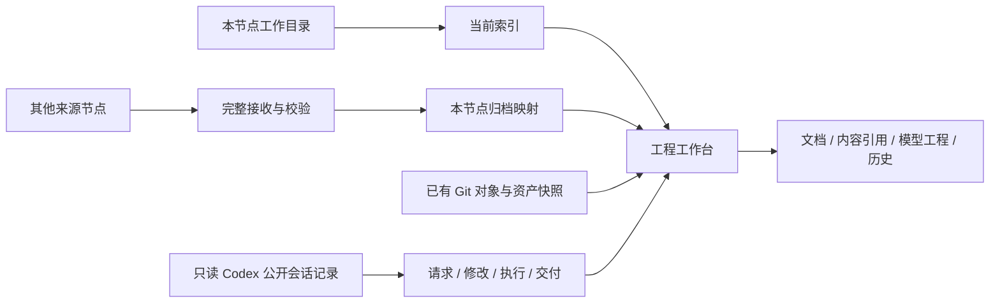

# 0.4 架构评估与升级审查

目标是让用户围绕工程完成查看、定位、理解、获取、更新操作，同时保留来源、证据和历史边界。

| 审查发现 | 影响 | 本次调整 |
| --- | --- | --- |
| 以资产总数和文件列表为主 | 难以找到当前工程和最近变化 | 新工作台、常用工程、知识搜索、最近开发轮次、待查看事项 |
| 来源工作目录与目标归档混合显示 | 容易把历史或远端原路径当成本机现状 | 独立节点身份、位置模式、当前归档清单；文件树默认当前映射 |
| 同一路径恢复为旧内容时按插入顺序取版本 | 可能显示错误的当前内容 | 目标清单显式指向当前内容 SHA-256，历史版本独立保留 |
| 会话开发过程缺失 | 产物修改动机和迭代依据难以追溯 | 只读会话适配器，轮次、变更、执行结果、修改说明与证据图 |
| 只有手动刷新 | 页面索引可能过期 | 后台逐工程轮询、节点版本轮询、同步发布触发刷新 |
| 上传更新与原文件修改没有清楚的流程 | 用户无法从工程页完成可审查修改 | 原文件编辑、差异确认、内容冲突检测、前后备份与审计 |
| 固定主机名称、SSH 目标与个人 QA 路径进入工具 | 不适合通用部署与公开仓库 | 通用节点配置、服务安装器、SSH 隧道参数、可验证发布安装器 |

## 信息层次

会话事件提供“哪一轮尝试或完成了哪个文件操作”的证据。真正的设计依赖来自内容引用或人工确认。不同证据不混成同一种边。未保存历史、动态路径、专有模型语义、外部工具改动属于明确的覆盖缺口。

## 数据与操作边界

- 节点身份、显示名称、会话来源、SSH 目标在运行数据或环境中配置，实例值不在源码中。
- 来源目录扫描只读。历史浏览不切换 Git 状态。首次纳管和目录迁移继续使用明确确认流程。
- 原文件编辑是单独操作：路径约束 → 读取基线 → 暂存新内容 → 显示差异 → 用户确认 → 再验证基线 → 原子替换 → 审计。无法阻止外部程序在最后检查与替换之间极短窗口内写入，因此避免同时使用多个编辑器保存同一文件。
- SHA-256 对象不可变；版本、当前映射和索引采样分别记录。
- 开发记录可同步到私人归档节点，但不进入 GitHub 源码发布。
- Codex 本地投影适配器只查询允许的公开 item 类型，不读取 reasoning 条目、认证或通用日志。

## 验证重点

自动测试覆盖来源数据库不变、会话幂等导入、格式不匹配、凭据遮盖、失败操作、编辑冲突、回放拒绝、符号链接拒绝、变更检测、历史文件范围和当前内容回退。原有模型、Git 历史、上传、同步与备份测试保留。

浏览器验证工作台、搜索、开发图、修改差异、目录范围、桌面与手机布局，并检查运行时 JavaScript 错误。部署后核验版本、节点身份、会话数量、目标映射与实际读取内容。

## 继续保留的边界

后台为元数据轮询，不保证即时事件或捕获两次扫描之间短暂存在的文件。会话格式检查仅支持已验证的本地 schema。模型查看器只支持列出的格式，专有 CAD 特性仍需原生工具。公共 HTTPS 只有在实际域名和主机网络配置到位后才能验证。Docker 配置需要在具备 Docker 的目标环境另行验收。
